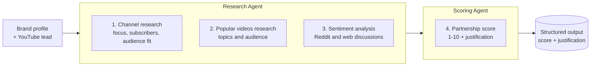

# AI Dual-Agent Influencer Partnership Scoring


A two-agent [CrewAI](https://www.crewai.com/) workflow that researches a YouTube creator and scores how well they fit a brand for an influencer partnership. A **Research Agent** gathers evidence from the web and YouTube, and a **Scoring Agent** turns that evidence into a 1–10 score with a written justification.

[](https://colab.research.google.com/github/vjabarca/AI-Agent-Influencer-Partnership-Scoring/blob/main/AI_Dual-Agent_Influencer_Partnership_Scoring.ipynb)

## Table of Contents

- [The Problem](#the-problem)
- [How It Works](#how-it-works)
- [Example Output](#example-output)
- [Tech Stack](#tech-stack)
- [Installation](#installation)
- [Configuration](#configuration)
- [Usage](#usage)
- [Customizing the Brand](#customizing-the-brand)
- [Project Structure](#project-structure)
- [Known Issues & Limitations](#known-issues--limitations)
- [Roadmap](#roadmap)
- [Contributing](#contributing)
- [License](#license)
- [Author & Support](#author--support)

## The Problem

Vetting a creator for a brand partnership is slow. Someone has to watch videos, estimate reach and engagement, read community discussions for sentiment, and then decide whether the creator's audience matches the brand's values. This project automates the first pass: it produces a structured research report and a defensible fit score in a few minutes, so a human can spend their time on the shortlist instead of on the initial screening.

## How It Works

The crew runs **sequentially**. Three research tasks feed their outputs into one scoring task.



| Agent | Role | Tools |
|---|---|---|
| Research Agent | Influencer researcher | `SerperDevTool`, `ScrapeWebsiteTool`, `YoutubeChannelSearchTool`, `YoutubeVideoSearchTool` |
| Scoring Agent | Partnership scoring agent | none (reasons over the research context) |

The final score is validated with a Pydantic model, so the output is always machine-readable:

```python
class Score(BaseModel):
    score: int          # 1-10
    justification: str  # what fits the brand and what does not
```

## Example Output

The notebook ships with a sample run: the brand is **Zero to Mastery** (an online tech academy) and the lead is the YouTube channel **Theo - t3.gg**.

```json
{
  "score": 8,
  "justification": "Strong fit for a developer-focused learning audience. Long-form tutorials and project builds align with career-focused learning and up-to-date tech stacks. Not a perfect fit: the channel mixes instruction with opinionated commentary, and public discussion of the creator is polarized. Validate recent performance and audience data before committing."
}
```

The run also produces three Markdown reports (channel research, popular videos, sentiment) that explain how the score was reached. This output is a point-in-time snapshot; subscriber counts and view numbers change.

<!-- VISUALS TODO: add a screenshot or GIF of a crew run (verbose agent log) and of the rendered reports, e.g.

-->

## Tech Stack

- **Language:** Python 3
- **Agent framework:** [CrewAI](https://github.com/crewAIInc/crewAI) (`crewai[tools]`)
- **LLM:** OpenAI `gpt-4o` via `langchain_openai` (temperature 0.5)
- **Web search:** [Serper](https://serper.dev/) (Google Search API)
- **YouTube data:** `youtube-transcript-api` and CrewAI's YouTube tools
- **Validation:** Pydantic
- **Environment:** Jupyter / Google Colab (`nest_asyncio` for async execution inside a notebook)

## Installation

### Option A: Google Colab (as the notebook was written)

1. Upload `AI_Dual-Agent_Influencer_Partnership_Scoring.ipynb` to [Google Colab](https://colab.research.google.com/).
2. Add your API keys as Colab secrets (see [Configuration](#configuration)).
3. Run the cells top to bottom. The first cells install all dependencies.

### Option B: Run locally

```bash
# 1. Clone the repository
git clone https://github.com/vjabarca/AI-Agent-Influencer-Partnership-Scoring.git
cd AI-Agent-Influencer-Partnership-Scoring

# 2. Create and activate a virtual environment
python -m venv .venv
source .venv/bin/activate        # Windows: .venv\Scripts\activate

# 3. Install dependencies
pip install "crewai[tools]" youtube-transcript-api langchain_openai nest_asyncio jupyter

# 4. Launch the notebook
jupyter notebook AI_Dual-Agent_Influencer_Partnership_Scoring.ipynb
```

> **Local runs:** the notebook mounts Google Drive and reads keys with `google.colab.userdata`. Both are Colab-only. Remove those cells and set the environment variables shown below instead.

## Configuration

Two API keys are required.

| Variable | Used for | Where to get it |
|---|---|---|
| `OPENAI_API_KEY` | GPT-4o for both agents (and CrewAI memory embeddings) | [platform.openai.com](https://platform.openai.com/api-keys) |
| `SERPER_API_KEY` | Google Search for channel and sentiment research | [serper.dev](https://serper.dev/) |

**In Colab**, create two secrets (the key icon in the left sidebar) named `ai_agents_openai` and `serper_api`, then enable notebook access. The notebook reads them with:

```python
from google.colab import userdata
os.environ['OPENAI_API_KEY'] = userdata.get('ai_agents_openai')
os.environ['SERPER_API_KEY'] = userdata.get('serper_api')
```

**Locally**, export them in your shell (or load them from a `.env` file that is listed in `.gitignore`):

```bash
export OPENAI_API_KEY="sk-..."
export SERPER_API_KEY="..."
```

Never commit API keys to the repository.

## Usage

1. Run the setup cells (install packages, set API keys, create the LLM).
2. Review or edit the `brand_info` dictionary (see [Customizing the Brand](#customizing-the-brand)).
3. When prompted, enter the creator's name and channel URL:

   ```text
   Enter name of Youtuber: Theo - t3.gg
   Enter the url for the Youtube channel: https://www.youtube.com/@t3dotgg
   ```

4. Run the crew cell. It kicks off the four tasks in order and streams the agents' progress:

   ```python
   nest_asyncio.apply()
   result = await crew.kickoff_async(inputs=youtube_lead)
   ```

5. Read the results:

   ```python
   channel_research_output = result.tasks_output[0].raw   # channel focus, reach, audience fit
   videos_research_output  = result.tasks_output[1].raw   # popular videos and topics
   sentiment_output        = result.tasks_output[2].raw   # community sentiment
   scoring_output          = result.tasks_output[3].raw   # {"score": 8, "justification": "..."}
   ```

To evaluate another creator, re-run from the name and URL prompts onward.

## Customizing the Brand

The scoring is driven entirely by one dictionary, so you can point the workflow at any brand:

```python
brand_info = {
    "name": "Your Brand",
    "description": "What the brand does, in one or two sentences.",
    "brand_values": "The values the Scoring Agent grades against.",
    "ideal_partner": "The kind of channel and audience you want."
}
```

You can also edit each task's `description` and `expected_output` to change what the Research Agent looks for, or the scoring prompt to change how the Scoring Agent weighs fit.

## Project Structure

```text
.
├── AI_Dual-Agent_Influencer_Partnership_Scoring.ipynb   # the full workflow
└── README.md
```

Notebook sections: **Setup**, **Data Inputs**, **Research**, **AI Scoring Agent**, **Build the AI Crew**.

## Known Issues & Limitations

- **Colab-specific:** Drive mounting and `userdata` secrets only work in Google Colab; local use needs the small changes noted above.
- **Interactive input:** the creator name and URL come from `input()` prompts, so the notebook scores one creator per run and is not yet batch-friendly.
- **Public data only:** subscriber counts, view counts, and engagement are pulled from search snippets and public listings. They are approximate, can be out of date, and do not include private analytics such as retention or audience demographics.
- **Sentiment is qualitative:** it reflects what Google Search surfaces (often Reddit) and can overrepresent strong opinions. It is not a representative survey.
- **LLM variability:** scores and reports can differ between runs. Treat the score as decision support for a human reviewer, not a final verdict.
- **Cost and latency:** each run makes multiple GPT-4o and Serper calls, so API usage adds up when evaluating many creators.
- **Unpinned dependencies:** package versions are not pinned, and CrewAI changes quickly. A future release may require code updates.

## Roadmap

- [ ] Batch mode: score a list of creators and output a ranked CSV
- [ ] Export reports and scores to files (Markdown/JSON) instead of notebook display only
- [ ] Add a `requirements.txt` with pinned versions
- [ ] Make the notebook run locally without Colab-specific cells
- [ ] Add quantitative signals (upload frequency, like-to-view ratio) to the scoring rubric
- [ ] Add a configurable scoring rubric with weighted criteria
- [ ] Optional lightweight UI (e.g., Streamlit) for non-technical users

## Contributing

Contributions, bug reports, and feature ideas are welcome.

1. **Report a bug or request a feature:** open an [issue](https://github.com/vjabarca/AI-Agent-Influencer-Partnership-Scoring/issues) and include what you expected, what happened, and your environment (Colab or local, CrewAI version).
2. **Submit a change:**
   1. Fork the repository
   2. Create a branch: `git checkout -b feature/your-feature`
   3. Commit your changes with a clear message
   4. Push the branch and open a pull request describing what changed and why

Please clear notebook outputs and make sure no API keys appear in the notebook before committing.

## License

Distributed under the MIT License. See [`LICENSE`](LICENSE) for details.

## Author & Support

**Victor J. Abarca**, San José, CA

- GitHub: [@vjabarca](https://github.com/vjabarca)

For questions or problems, please open an issue in this repository.

## Acknowledgments

- [CrewAI](https://www.crewai.com/) for the multi-agent framework
- [Serper](https://serper.dev/) for the search API
- Zero to Mastery, used as the example brand in the sample run
